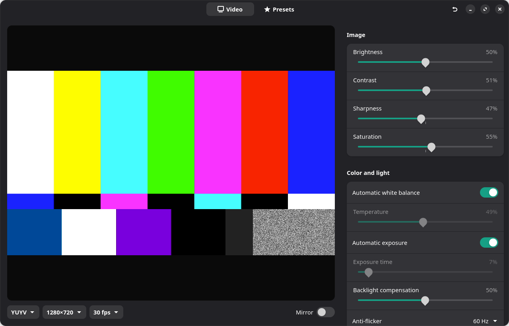
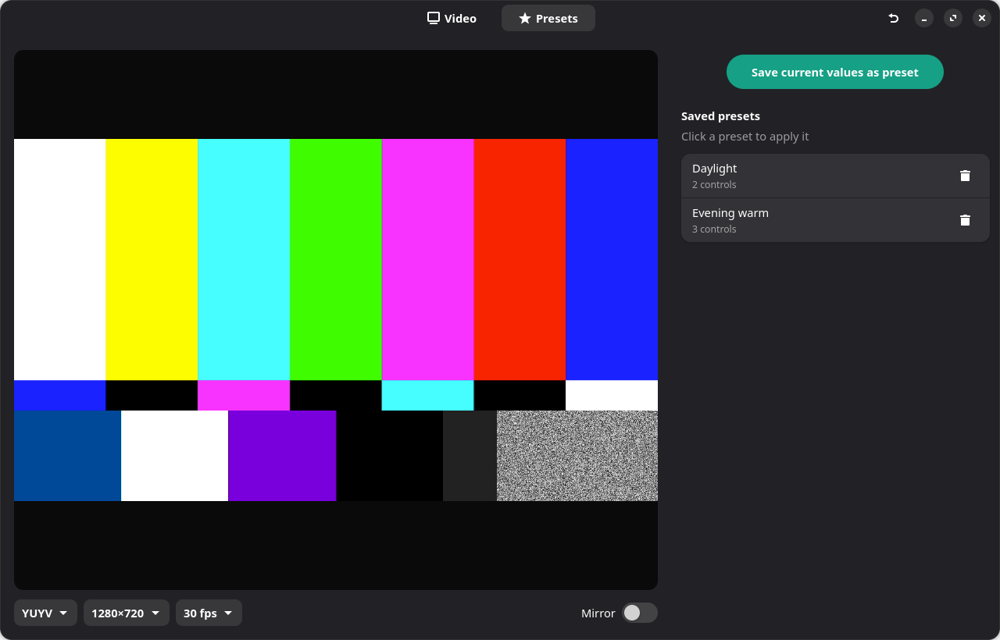

# emeet-linux

Control panel for EMEET webcams on Linux, with a live preview. EMEET only ships
eMeetLink for Windows and macOS; this covers what the camera exposes over
standard UVC controls without opening OBS.





## Supported cameras

Any EMEET webcam works: SmartCam S600, C960, C980, Nova, PIXY and the rest.
Nothing is tied to a model. The app finds the first USB camera, asks it which
controls and formats its firmware exposes over UVC, and builds the panel from
that. So does any other UVC webcam (Logitech, Anker, built-in laptop cameras).

What you get on every camera:

- Live preview with format, resolution, frame rate and mirror.
- Every control the firmware reports: brightness, contrast, saturation,
  sharpness, white balance, exposure, anti-flicker, zoom, pan, tilt, and so on.
  Which ones appear depends on the model.
- Named presets, saved per app, and reset to the camera defaults.

The only model-specific part is `emeet/quirks.py`: a table of stream modes in
which a camera ignores zoom, measured on the SmartCam S600. Other models work
without an entry; they just do not get the hint.

## Install

### Flatpak

Download `io.github.breno5g.emeet.flatpak` from the latest release and run:

```
flatpak install ./io.github.breno5g.emeet.flatpak
```

It needs the Flathub remote for the GNOME 48 runtime. Presets and settings live
in `~/.var/app/io.github.breno5g.emeet/config/emeet-linux/`.

To build it yourself from a checkout:

```
flatpak install flathub org.gnome.Sdk//48
flatpak run org.flatpak.Builder --user --install --force-clean build-dir io.github.breno5g.emeet.json
```

### Tarball

Download `emeet-linux-vX.Y.Z.tar.gz` from the latest release, extract it and run:

```
./install.sh
```

It installs the distro packages the app needs (Arch, Debian/Ubuntu and Fedora
are handled, others print the list), the app into your user site-packages, and a
menu entry. Then run `emeet` or open EMEET Webcam from the app menu.
`./install.sh --uninstall` removes it.

From a checkout, the same script works, or just:

```
python -m emeet              # auto-detects the first USB camera
python -m emeet /dev/video2  # or pick one
```

Needs `v4l2-ctl` (v4l-utils), GTK 4, libadwaita, GStreamer with the
`gtk4paintablesink` plugin (gst-plugin-gtk4), and PyGObject.

## Release

Push a tag like `v0.2.0`. The release workflow sets that version, builds the
wheel, assembles the tarball and publishes a GitHub release with checksums.
The test workflow runs the suite under Xvfb on every push and pull request.

## Test

```
python -m unittest discover -s tests
```

The UI tests build real widgets with a fake camera and are skipped when there is
no display.

## Layout

| Path | Role |
|---|---|
| `emeet/v4l2.py` | Parse `v4l2-ctl` output, `Camera` wrapper, device discovery |
| `emeet/pipeline.py` | GStreamer pipeline description for the preview |
| `emeet/quirks.py` | Per-camera firmware quirks (zoom modes) |
| `emeet/presets.py` | Presets and settings, JSON in `~/.config/emeet-linux/` |
| `emeet/ui.py` | GTK4 + libadwaita window: preview, controls, presets |
| `emeet/__main__.py` | Entry point |

## Not covered

Firmware effects from eMeetLink (BlackWhite, Cartoon, HDR, AI framing) live behind
EMEET's proprietary UVC extension unit and are not exposed as v4l2 controls.

## Camera quirks (SmartCam S600, firmware as of 2026-10)

Digital zoom is accepted in every mode but only changes the image in some.
Measured by capturing frames at zoom 100 and 150 straight from `v4l2src`:

| Mode | Zoom |
|---|---|
| MJPG 1920×1080 @ 30 | works |
| MJPG 1280×720 @ 60 | works |
| MJPG 640×360 @ 30 | works |
| MJPG 1920×1080 @ 60 | no effect |
| MJPG 3840×2160 @ 30 | no effect |
| YUYV 640×480 @ 30 | no effect |

The app greys out the zoom slider in those modes with a hint. The table lives in
`emeet/quirks.py`; add a line for another camera after measuring it the same way.
